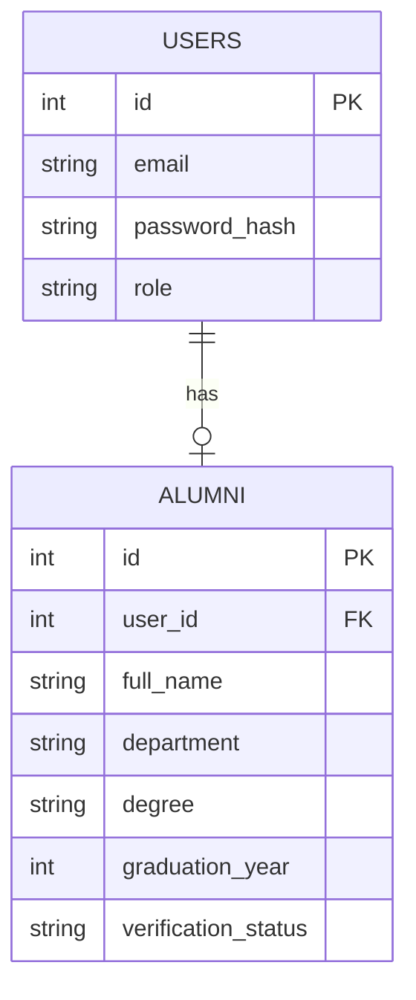

# LegacyLink

**Connections that last. Legacies that grow.**

LegacyLink is a college-specific alumni networking platform designed to connect former students, help alumni maintain professional relationships, and support mentorship and career opportunities.

## Technology Stack

- Python
- Flask
- Flask-SQLAlchemy
- SQLite
- HTML and CSS

## Database Structure

LegacyLink currently uses SQLite for development.

### 1. Users Table

Stores account and login information.

- `id`: Unique user ID (primary key)
- `email`: User email address (unique)
- `password_hash`: Securely hashed password
- `role`: User role
- `email_verified`: Email verification status
- `created_at`: Account creation date

### 2. Alumni Table

Stores alumni profile information.

- `id`: Unique alumni profile ID (primary key)
- `user_id`: Linked user ID (foreign key)
- `full_name`: Alumni name
- `department`: Academic department
- `degree`: Degree obtained
- `graduation_year`: Graduation year
- `occupation`: Current occupation
- `company`: Current company
- `skills`: Alumni skills
- `bio`: Profile description
- `verification_status`: Pending, approved, or rejected
- `is_visible`: Directory visibility
- `verified_by`: Admin user ID who verified the profile
- `verified_at`: Verification date and time
- `created_at`: Profile creation date

## Relationships

- One user can have one alumni profile.
- Alumni profiles are linked to users through `user_id`.
- Each alumni profile can be reviewed through the verification process.

## Security and Verification

- Passwords are stored as hashes, never as plain text.
- Email addresses must be unique.
- New alumni profiles start with pending verification.
- Only approved and visible profiles should appear in the alumni directory.
- Admin accounts should be created through an authorized process.

## Project Setup

1. Clone the repository.
2. Create and activate a Python virtual environment.
3. Install dependencies using `pip install -r requirements.txt`.
4. Run the application using `python app.py`.

## Future Improvements

- Alumni search and filtering
- Admin verification dashboard
- CSV import for authorized alumni records
- Mentorship and networking features
- Career opportunities and events
- PostgreSQL database for production deployment

## Entity Relationship Diagram

