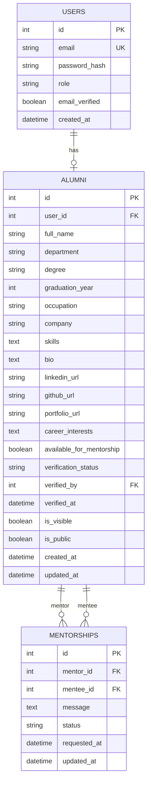

# LegacyLink

**Connections that last. Legacies that grow.**

LegacyLink is a college-specific alumni networking platform designed to connect former students, strengthen professional relationships, and support mentorship and career development.

The platform aims to create a space where alumni can reconnect with their institution, share professional experiences, discover opportunities, and guide current students.

## Features

### Alumni Profiles
- Alumni profile creation and management
- Enhanced professional profiles
- Department and graduation year information
- Company and occupation details
- Skills, biography, and career interests
- LinkedIn, GitHub, and portfolio links
- Alumni visibility and privacy settings

### Verification and Security
- Admin-based alumni verification
- Pending, approved, and rejected verification statuses
- Secure password hashing
- Unique user email addresses
- Role-based account support

### Alumni Directory
- Database support for department filtering
- Graduation year filtering
- Company filtering
- Skills-based filtering support
- Indexed database columns for improved query performance

### Mentorship
- Alumni mentorship availability preference
- Mentorship request creation
- Mentor and mentee relationships
- Pending, accepted, and rejected request statuses
- Prevention of self-mentorship requests

*Note: These features describe implemented database support. Complete API and frontend integration may depend on the work of the backend and frontend teams.*

## Technology Stack

- Python
- Flask
- Flask-SQLAlchemy
- SQLAlchemy
- Flask-Migrate
- Alembic
- SQLite (local development)
- PostgreSQL (planned production database)
- HTML and CSS
- Git and GitHub

## Database Structure

LegacyLink uses a relational database with three main tables:

1. `users`
2. `alumni`
3. `mentorships`

### 1. Users Table

Stores account and authentication information.

| Column | Description |
|---|---|
| id | Primary key |
| email | Unique user email |
| password_hash | Securely hashed password |
| role | User role |
| email_verified | Email verification status |
| created_at | Account creation timestamp |

### 2. Alumni Table

Stores alumni academic, personal, and professional profile information.

| Column | Description |
|---|---|
| id | Primary key |
| user_id | Foreign key referencing users.id; nullable and unique |
| full_name | Alumni full name |
| department | Academic department |
| degree | Degree obtained |
| graduation_year | Year of graduation |
| occupation | Current occupation |
| company | Current company |
| skills | Professional skills |
| bio | Profile description |
| linkedin_url | LinkedIn profile URL |
| github_url | GitHub profile URL |
| portfolio_url | Portfolio website |
| career_interests | Career interests |
| available_for_mentorship | Mentorship availability |
| verification_status | Pending, approved, or rejected |
| verified_by | Admin user ID who verified the profile |
| verified_at | Verification timestamp |
| is_visible | Directory visibility |
| is_public | Public profile visibility |
| created_at | Profile creation timestamp |
| updated_at | Last profile update timestamp |

### 3. Mentorships Table

Stores mentorship requests between alumni.

| Column | Description |
|---|---|
| id | Primary key |
| mentor_id | Foreign key referencing alumni.id |
| mentee_id | Foreign key referencing alumni.id |
| message | Optional mentorship request message |
| status | Pending, accepted, or rejected |
| requested_at | Request creation timestamp |
| updated_at | Last request update timestamp |

## Entity Relationships

- One user can have at most one linked alumni profile.
- An alumni profile can exist without a linked user account, allowing authorized CSV imports.
- Each alumni profile can be associated with multiple mentorship requests as a mentor or mentee.
- Each mentorship request references one mentor and one mentee.
- A mentorship request cannot reference the same alumni as both mentor and mentee.

## Entity Relationship Diagram



## Database Constraints and Validation

### Users
- Email addresses must be unique.
- Passwords are stored as hashes.

### Alumni
- `user_id` must reference a valid user when provided.
- Each user can have at most one linked alumni profile.
- Full name, department, and degree are required.
- Graduation year must be within the supported validation range.
- Verification status must be `pending`, `approved`, or `rejected`.

### Mentorships
- Mentor and mentee IDs must reference existing alumni profiles.
- Mentor and mentee must be different alumni.
- Status must be `pending`, `accepted`, or `rejected`.

## Database Indexes

Indexes are used to improve directory search performance.

The Alumni table includes indexes on:

- `department`
- `graduation_year`
- `company`

The Mentorships table includes indexes on:

- `mentor_id`
- `mentee_id`

## Security and Verification

- Passwords are stored using secure password hashing.
- New alumni profiles start with pending verification.
- Pending and rejected profiles should remain hidden from the verified alumni directory.
- Only approved and visible profiles should appear in the directory.
- Admin accounts must be created through an authorized process.
- Alumni visibility and public profile settings are stored separately.

## CSV Import

LegacyLink supports alumni profile data import through CSV files.

- CSV files are processed using Python's `csv` module.
- Duplicate detection checks full name, department, and graduation year.
- Imported profiles start with pending verification.
- Imported profiles can exist without linked user accounts.
- Imported records should be reviewed before appearing in the directory.

## Database Migrations

LegacyLink uses Flask-Migrate and Alembic to manage database schema changes.

Apply migrations:

```bash
flask --app app db upgrade
```

Generate a new migration after modifying database models:

```bash
flask --app app db migrate -m "Describe your changes"
```

Check the current migration:

```bash
flask --app app db current
```

View migration history:

```bash
flask --app app db history
```

## Database Testing

The database has been tested for:

- User creation and email uniqueness
- Alumni profile creation
- Required field validation
- Graduation year validation
- Verification status validation
- Alumni-user foreign-key integrity
- Mentorship request creation
- Invalid mentorship status rejection
- Prevention of self-mentorship requests
- Database foreign-key integrity
- Orphaned alumni records

Run the test suite:

```bash
pytest -v
```

Run the database integrity checker:

```bash
python check_database_integrity.py
```

## Project Setup

### 1. Clone the repository

```bash
git clone https://github.com/varshaarun1211/LegacyLink.git
cd LegacyLink
```

### 2. Create a virtual environment

```bash
python -m venv venv
```

### 3. Activate the virtual environment

Windows PowerShell:

```powershell
.\venv\Scripts\Activate.ps1
```

### 4. Install dependencies

```bash
pip install -r requirements.txt
```

### 5. Apply database migrations

```bash
flask --app app db upgrade
```

### 6. Run the application

```bash
python app.py
```

## Future Improvements

- Complete frontend and backend integration of alumni directory filters
- Mentorship request API and frontend integration
- Career opportunities and job postings
- Alumni events and networking features
- PostgreSQL production database
- Production deployment on Render
- Expanded automated testing

## Project Contribution

LegacyLink is developed collaboratively.

The database layer supports:
- User account storage
- Alumni profile management
- Verification-related data
- Directory filtering support
- Mentorship request storage
- Database migrations and integrity testing

Backend APIs and frontend interfaces are developed and integrated as part of the wider project.

## Project Motto

**Connections that last. Legacies that grow.**
